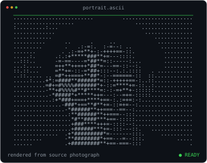

<code>adryan@github ~ $ ./contributions.sh</code>

<code>adryan@github ~ $ whoami</code>

<table align="center">
<tr>
<td width="50%" valign="top"></td>
<td width="50%" valign="top">

</td>
</tr>
</table>

<code>adryan@github ~ $ ./stack.sh</code>

<code>Software Engineering · Goianésia, BR · build / learn / repeat</code>

<a href="https://www.linkedin.com/in/adryan-ribeiro-6231793a7/">LinkedIn</a> · <a href="https://github.com/Adryanrib?tab=repositories">Projetos</a>

