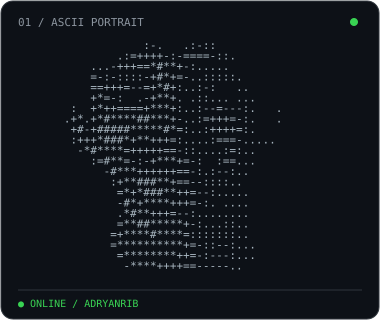

  

  
  

  

  
  

  
  
  

---

### 👋 Sobre mim

Tenho 18 anos e sou natural de Goianésia, Goiás. Desde criança sempre tive grande interesse por tecnologia e computação, o que me motivou a seguir na área de desenvolvimento de software. Atualmente curso Engenharia de Software, buscando evoluir tanto na parte técnica quanto na construção de soluções práticas e eficientes.

---

### 🛠️ Linguagens e Tecnologias

  

