<h3><code>adryanribee@github ~ $ ./contributions.sh</code></h3>

 
 

<h3><code>adryanribee@github ~ $ whoami</code></h3>

<table>
<tr>
<td valign="top"></td>
<td valign="top"></td>
</tr>
</table>

 
 

<h3><code>adryan@github ~ $ ./links.sh</code></h3>

<b>Software Engineering Student · IT · Development · Automation</b>

 

<!-- Layout reference: https://github.com/AVIVASHISHTA29/AVIVASHISHTA29/tree/b7b4dbd07dab48370ef6e3957d4fa7f2ce76acdf -->
